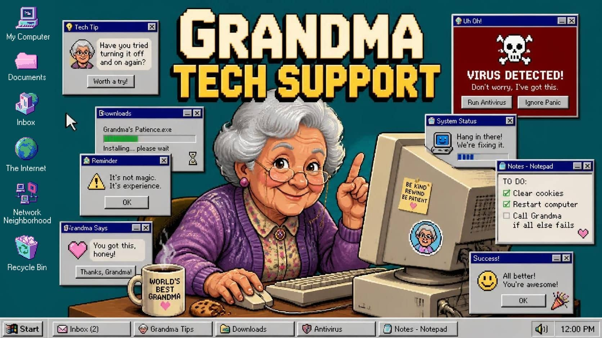

<p align="center">
  
</p>

# Grandma Tech Support

[](https://github.com/remarkablegames/grandma-tech-support/actions/workflows/build.yml)
[](https://github.com/remarkablegames/grandma-tech-support/actions/workflows/test.yml)
[](https://codecov.io/gh/remarkablegames/grandma-tech-support)

👵🛠️ Grandma needs help with her computer. Follow her instructions, dodge suspicious windows, and try not to break anything important.

Play in your browser:

- [Wavedash](https://wavedash.com/games/grandma-tech-support)
- [itch.io](https://remarkablegames.itch.io/grandma-tech-support)
- [remarkablegames](https://remarkablegames.org/grandma-tech-support/)

Or download for desktop:

- [Windows](https://github.com/remarkablegames/grandma-tech-support/releases/latest/download/windows.zip)
- [macOS](https://github.com/remarkablegames/grandma-tech-support/releases/latest/download/macos.zip)
- [Linux](https://github.com/remarkablegames/grandma-tech-support/releases/latest/download/linux.zip)

## Features

- A humorous point-and-click puzzle game set on a fictional Windows 95-style desktop
- Help Grandma complete 8 tasks while dodging fake warnings, misleading pop-ups, and other computer mishaps
- There’s no lose state: wrong clicks trigger jokes, and you can try again
- Estimated playtime: 10-15 minutes

## Credits

- [𝕎𝕚𝕟𝕕𝕠𝕨𝕤 𝟡𝟝 ~𝓒𝓪𝓵𝓶𝓲𝓷𝓰~ Icon Pack](https://aconfuseddragon.itch.io/windows-95-calming)
- [Paradise Road Trip - The Original Soundtrack](https://fricochet.itch.io/paradise-road-trip-ost)
- [Kenney Interface Sounds](https://kenney.nl/assets/interface-sounds)
- [W95FA font](https://www.dafont.com/w95fa.font)

## Install

Clone the repository:

```sh
git clone https://github.com/remarkablegames/grandma-tech-support.git
cd grandma-tech-support
```

Install the dependencies:

```sh
npm install
```

## Available Scripts

In the project directory, you can run:

### `npm start`

Runs the app in development mode.

Open [http://127.0.0.1:5173](http://127.0.0.1:5173) to view it in the browser.

The page will reload if you make edits.

You will also see any errors in the console.

### `npm run build`

Builds the app for production to the `dist` folder.

It correctly bundles in production mode and optimizes the build for the best performance.

The build is minified and the filenames include the hashes.

Your app is ready to be deployed!

### `npm run lint`

Checks the code quality.

### `npm run lint:tsc`

Checks for type errors.

### `npm test`

Runs the tests.
